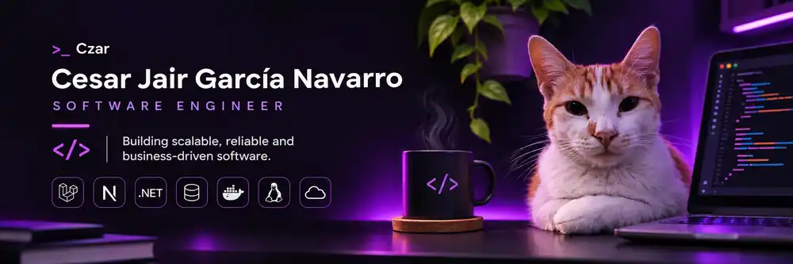
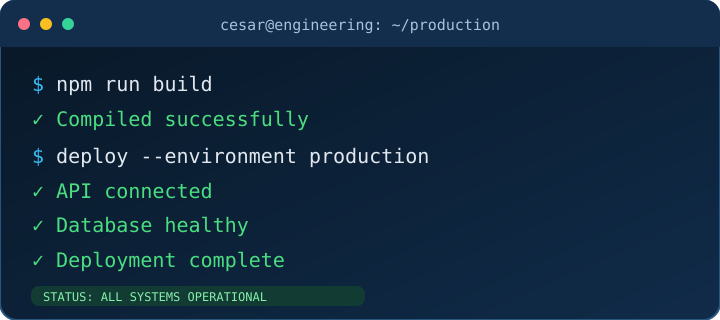

<!--
  CESAR JAIR GARCÍA NAVARRO — GitHub Profile
  Brand system: midnight black / deep violet / lavender.
  Assets live in ./assets; contribution animation is generated by .github/workflows/snake.yml.
-->

<div align="center">

  

  <a href="https://czarrazc.com">
    
  </a>

  <p>
    <a href="https://czarrazc.com"></a>
    <a href="https://www.linkedin.com/in/czarrazc/"></a>
    <a href="mailto:cjair320@gmail.com"></a>
  </p>

  <p>
    
    
    
  </p>

  <a href="#about">About</a> &nbsp;·&nbsp;
  <a href="#expertise">Expertise</a> &nbsp;·&nbsp;
  <a href="#stack">Tech Stack</a> &nbsp;·&nbsp;
  <a href="#work">Selected Work</a> &nbsp;·&nbsp;
  <a href="#experience">Experience</a> &nbsp;·&nbsp;
  <a href="#activity">Activity</a> &nbsp;·&nbsp;
  <a href="#connect">Connect</a>

</div>

---

<a id="about"></a>
## 👋 More than writing code

I'm **Cesar Jair García Navarro**, a Full Stack Software Engineer based in **Guadalajara, Mexico**. I build practical, maintainable software — from business platforms and third-party integrations to industrial data solutions — and care about the full journey from architecture to deployment. My core toolkit includes **Laravel / Livewire / Filament, Next.js, ASP.NET Core and SQL Server**.

<table>
  <tr>
    <td width="56%" valign="middle">
      <b>What I bring to a team</b>
      <p>🏗️ <b>Architecture-first:</b> clear boundaries, scalable designs and maintainable code.</p>
      <p>🔗 <b>Integration mindset:</b> REST APIs, SQL data flows and third-party services.</p>
      <p>🛠️ <b>End-to-end ownership:</b> frontend, backend, databases and Linux VPS deployment.</p>
      <p>⚙️ <b>Real-world domains:</b> business software, ERPs, internal systems and PLC data collection.</p>
    </td>
    <td width="44%" valign="middle" align="center">
      
    </td>
  </tr>
</table>

```yaml
engineer:
  name: "Cesar Jair García Navarro"
  title: "Full Stack Software Engineer"
  education: "Software Development & Management Engineering · UTJ"
  location: "Guadalajara, Jalisco, Mexico"
  focus: ["Enterprise Software", "APIs", "Industrial Integrations"]
  approach: ["Design", "Build", "Optimize", "Deploy"]
  opportunities: ["Full Stack", "Backend", "Software Engineering"]
```

<a id="expertise"></a>
## 🧩 Engineering expertise

| 🏢 Enterprise software | 🔌 APIs & integrations | 🗄️ Data & performance | 🚀 Delivery & operations |
| :--- | :--- | :--- | :--- |
| ERP features, internal platforms and business workflows | REST APIs, external services and industrial PLC connectivity | Relational modeling, T-SQL, MySQL and query optimization | Git workflows, Linux VPS, Nginx, Docker and production deployments |

<a id="stack"></a>
## 🧰 Tools I build with

**Frontend & user experience**


**Backend & application frameworks**


**Data, infrastructure & tooling**


<p>
  
  
  
  
  
  
</p>

<a id="work"></a>
## 🚀 Selected work

> A few examples of the kinds of problems I like solving. Some professional projects are private, so the links below focus on public work and portfolio case studies.

<table>
  <tr>
    <td width="50%" valign="top">
      <h3>🏋️ GoFitMx — Gym management</h3>
      <p>Web platform for gym administration, with Laravel-based workflows and an admin interface built with Filament and Livewire.</p>
      <p><code>Laravel</code> <code>PHP</code> <code>Filament</code> <code>Livewire</code></p>
      <a href="https://github.com/CzarGarcia/GoFitMx"><b>↗ View repository</b></a>
    </td>
    <td width="50%" valign="top">
      <h3>📱 GoFitMx Mobile</h3>
      <p>Companion mobile project exploring cross-platform development with React Native, TypeScript and Expo.</p>
      <p><code>React Native</code> <code>TypeScript</code> <code>Expo</code></p>
      <a href="https://github.com/CzarGarcia/GoFitMxMobile"><b>↗ View repository</b></a>
    </td>
  </tr>
  <tr>
    <td width="50%" valign="top">
      <h3>🏭 Industrial PLC data collector</h3>
      <p>Industrial data collection solution with a Windows Forms desktop implementation and an ASP.NET Core web version, including external API integrations.</p>
      <p><code>C#</code> <code>Windows Forms</code> <code>ASP.NET Core</code></p>
      <a href="https://czarrazc.com"><b>↗ Explore on my portfolio</b></a>
    </td>
    <td width="50%" valign="top">
      <h3>🌐 Portfolio — From v1 to today</h3>
      <p>A look at my progress, from an early HTML/CSS/JavaScript portfolio to my current professional presence.</p>
      <p><code>HTML</code> <code>CSS</code> <code>JavaScript</code> <code>Next.js</code></p>
      <a href="https://github.com/CzarGarcia/PortafolioPersonal"><b>↗ V1 source</b></a> ·
      <a href="https://czarrazc.com"><b>Current site</b></a>
    </td>
  </tr>
</table>

<div align="center">
  <a href="https://github.com/CzarGarcia?tab=repositories">
    
  </a>
</div>

<a id="experience"></a>
## 💼 Professional journey

| Period | Role | Highlights |
| :--- | :--- | :--- |
| **Nov 2025 – Present** | **Full Stack Developer · En-trega** | Internal software development and maintenance, new features, PHP and T-SQL. |
| **Jun 2024 – Nov 2025** | **Full Stack Developer · Netcommerce** | Web application development and maintenance using Laravel, Vue, Livewire and Filament. |
| **May 2023 – Jun 2024** | **Full Stack Developer · IDEB** | Legacy refactoring, internal software and systems/server administration. |

**How I work:** understand the problem → define the data & architecture → implement carefully → ship → iterate.

<a id="activity"></a>
## 🐍 My contribution trail

<div align="center">
  <picture>
    <source media="(prefers-color-scheme: dark)" srcset="https://raw.githubusercontent.com/CzarGarcia/CzarGarcia/output/github-snake-dark.svg" />
    <source media="(prefers-color-scheme: light)" srcset="https://raw.githubusercontent.com/CzarGarcia/CzarGarcia/output/github-snake-light.svg" />
    
  </picture>
  <sub>Generated automatically from GitHub contributions through a scheduled workflow.</sub>
</div>

<a id="connect"></a>
## 🤝 Let's build something valuable

I am interested in **Full Stack, Backend and Software Engineering opportunities**, especially where clean architecture and reliable delivery make a real difference.

<div align="center">
  <p><b>Have a role, a challenge or an interesting product idea?</b></p>
  <a href="mailto:cjair320@gmail.com"></a>
  <a href="https://www.linkedin.com/in/czarrazc/"></a>
  <a href="https://czarrazc.com"></a>
  <p><sub>Designed with intention. Built with curiosity. Always improving.</sub></p>
</div>

<!-- Thanks for visiting! -->
